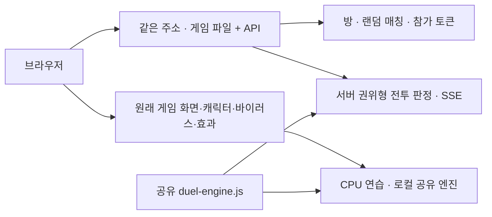

# 프론트엔드·서버 구조 (1.5.0)



- `frontend/`: 원래 게임·입력·기록·렌더러를 유지합니다. `duel-view.js`는 왼쪽에 원래 경기장을 사용하고, 오른쪽 상대 경기장을 같은 대전 상태와 그래픽으로 그립니다. 듀얼을 나가면 싱글플레이 상태를 복원합니다. `duel.js`는 매치 수명·입력·CPU·온라인 연결을 담당합니다.
- `frontend/js/duel-engine.js`: 브라우저와 Node에서 같은 규칙을 실행합니다. 원래 쉬움의 이동·패링·방향별 쿨다운에 듀얼 자원·연속 적중·승패를 적용합니다.
- `backend/`: 방·랜덤 매칭·인증과 서버 전투 판정. 입력을 받은 서버 시각으로 공유 엔진을 실행하고 상태를 전송합니다. 클라이언트가 보고한 점수·승패는 받지 않습니다.
- `scripts/dev_duel.cjs`: 게임 파일과 API를 같은 HTTP 서버에 연결합니다. 실제 프론트엔드 파일만 허용하고 `config.js`를 현재 페이지 origin으로 응답합니다. 소스 설정은 수정하지 않습니다. `serve.cjs`는 공개 호스트용 진입점입니다.
- `desktop/`: 기존 origin과 저장 경로를 보존하는 Electron 셸. 온라인은 브라우저에서 사용하고 앱에서는 싱글플레이·CPU 연습을 지원합니다.

## 실행과 배포

`npm run dev:duel`은 기본 `127.0.0.1:8000`, `npm run start:server`는 `0.0.0.0:8080`에서 게임과 API를 함께 제공합니다. 둘 다 `HOST`·`PORT`로 변경할 수 있으며 Node.js 22.12 이상에서 패키지 설치 없이 실행됩니다. 종료 시 SSE 응답을 먼저 끝내고 HTTP 요청에 짧은 유예 후 연결을 닫습니다.

공개 서비스는 `ALLOWED_ORIGINS`에 실제 페이지의 정확한 HTTP(S) origin을 지정합니다. `config.js`가 같은 주소를 사용하므로 통합 서버에서는 별도의 프론트엔드 API 주소 설정이 필요 없습니다. HTTPS는 호스트 프록시에서 처리합니다. 자세한 순서는 [SERVER.md](SERVER.md)에 있습니다.

```sh
docker build -f backend/Dockerfile -t neon-parry-server .
docker run --rm -p 8080:8080 \
  -e ALLOWED_ORIGINS=https://game.example.com \
  neon-parry-server
```

컨테이너는 `backend/`, `frontend/`, 서버 진입 스크립트만 복사하고 테스트·Electron은 포함하지 않습니다. API 전용은 `npm run start:backend` 또는 컨테이너 명령을 `node backend/server.cjs`로 바꿉니다. 공유 엔진 때문에 `backend/` 폴더만 단독 복사하면 실행되지 않습니다.

GitHub Actions는 테스트·컨테이너 health 검사 후 정적 `_site/`를 Pages에 배포합니다. Pages는 대전 서버를 실행하지 않습니다. 분리 구성에서는 `NEON_API_BASE_URL`에 공개 API 주소를 넣고 서버의 `ALLOWED_ORIGINS`에 Pages 출처를 허용합니다. 이번 변경은 공개 호스트를 생성하거나 배포하지 않습니다.

## 상태와 전송

방·매칭은 REST, 입력은 인증된 POST, 전투 상태는 인증된 fetch 기반 SSE를 사용합니다. `EventSource` 대신 fetch로 Bearer 토큰을 헤더에 보내 URL 노출을 피합니다. 모듈을 로드하는 것만으로 네트워크에 접속하지 않습니다.

친구방은 2~8명이 모두 준비하면 3초 뒤 시작합니다. 랜덤 매칭은 같은 서버에서 대기 중인 후보 중 무작위 상대를 골라 자동 준비된 방을 만듭니다. 대기권은 15초 유효하며 조회로 연장하고, 매칭 후 인계 유효시간은 60초입니다. 전투 SSE 연결에 성공하면 티켓 정리로 진행 중 경기가 취소되지 않습니다. 인계 전 취소·만료는 남은 상대를 다시 대기시킬 수 있습니다. 실력 등급·지역별 매칭은 없습니다.

전투 입력의 seq는 최근 128개 범위에서 중복을 막습니다. 새 듀얼은 서버가 측정한 지연으로 패링 수신 시각을 보정하고, SSE로 전투 변화와 연결 상태를 전송합니다. 방향별 패링 재사용 대기시간은 원래 게임처럼 독립적입니다. 상세 계약은 [ONLINE_API.md](ONLINE_API.md)를 참고하세요.

플레이어당 최대 두 SSE 연결을 허용하고, 15초 재연결 유예 뒤 기권 처리합니다. 직접 나가기도 기권입니다. 전투 시간제한은 없습니다. 최대 방 1,000개·매칭 티켓 2,000개이며, IP당 로비 300회/분·입력 1,800회/분·매칭 등록 30회/분을 제한합니다.

방·매칭은 한 프로세스 메모리에만 저장합니다. 인증된 활동이 없는 방은 15분 뒤 만료하며 활성 스트림은 수명을 연장합니다. 서버 재시작 시 상태는 사라집니다. 토큰은 본인에게만 반환하고 서버는 해시로 보관하며, 프론트엔드는 localStorage·URL에 저장하지 않습니다. 새로고침 복구·영구 전적·멀티 인스턴스 공유 상태·서버 과거 판정으로 되돌리는 지연 보정은 제공하지 않습니다.

## 검증

`npm test`는 기존 게임·데스크톱과 듀얼 규칙·원래 화면 복원·매칭·실제 HTTP·SSE·통합 서버를 확인합니다. CI는 컨테이너를 빌드해 게임 진입점과 health를 확인합니다. `_site/`에는 백엔드·테스트·환경 파일·원본 ZIP이 포함되지 않습니다.
