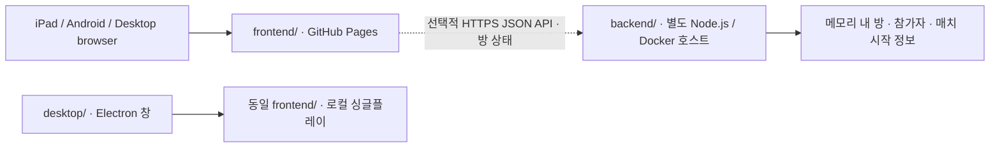

# 프론트엔드·백엔드 분리 (1.2.0)

## 책임과 배포 경계



- `frontend/`: 화면, 애니메이션, 소리, 입력, 현재 싱글플레이 판정·적 생성·기록. 프레임워크/빌드 의존성 없이 정적으로 실행합니다. `js/online-client.js`는 선택적 방 API 클라이언트이며 로드만으로 네트워크 요청을 보내지 않습니다.
- `backend/`: 브라우저 화면을 제공하지 않는 독립 서비스입니다. 두 참가자의 소속과 준비 상태를 관리하고 두 명 모두 준비하면 같은 매치 ID·시드·3초 뒤 시작 시각을 발급합니다. 클라이언트가 보낸 점수나 승패를 인정하는 API는 없습니다.
- `desktop/`: 웹 게임과 Electron 권한을 연결하는 셸입니다. 기존 로컬 origin과 저장 경로를 유지하며 프론트엔드/셸만 패키징합니다.

## 온라인 구현의 현재 경계

방 API와 프론트엔드 클라이언트는 두 독립 클라이언트가 같은 상태를 받는 것까지 검증했습니다. **매치 시작 정보는 대전이 완성되었다는 뜻이 아닙니다.** 현재 프론트엔드 게임은 API에 자동 접속하거나 매치 시드를 적용하지 않고, 싱글플레이 판정을 그대로 사용합니다.

다음 실제 듀얼 단계에서는 대전 규칙(승리 조건/공격/동일 적 배치), 서버 권위형 게임 상태·입력 검증, 전송 방식(WebSocket 등), 지연 보정·재접속을 정해야 합니다. 방의 REST 조회는 로비 상태용이며 정밀 패링 입력을 실시간 전송하기 위한 방식은 아닙니다. 도전과제/로컬 기록을 온라인 대전 순위 검증 데이터로 사용하지 않습니다.

## 실행

프론트엔드: 저장소 루트에서 `npm run dev:frontend` 또는 `python3 -m http.server 8000 --bind 127.0.0.1 --directory frontend`.

백엔드: 저장소 루트에서 `npm run start:backend`, 또는 백엔드만 복사해 `cd backend && npm start`. Node.js 22.12 이상이면 의존성 설치가 필요하지 않습니다. `.env.example`은 설정 예시일 뿐 자동 로드하지 않습니다. 호스트 환경변수를 설정하거나 Node의 `--env-file`을 사용하세요.

```sh
docker build -t neon-parry-backend ./backend
docker run --rm -p 8080:8080 \
  -e ALLOWED_ORIGINS=https://qqock2e.github.io \
  neon-parry-backend
```

`GET /health`로 상태를 확인합니다. 프론트엔드는 없어도 서비스가 실행되며, 반대로 백엔드 없이도 프론트엔드 싱글플레이가 동작합니다.

## 공개 배포

- 프론트엔드: Actions에서 테스트 후 `scripts/build_web.py`로 `_site/`를 생성하여 Pages에 올립니다.
- 백엔드: Docker/Node 실행을 지원하는 별도 호스트가 필요합니다. 호스트는 아직 지정·프로비저닝하지 않았습니다. Dockerfile과 CI 컨테이너 검사까지 제공합니다. GitHub에 코드를 올리는 것과 백엔드 프로세스를 공개 운영하는 것은 별도입니다.
- 공개 브라우저 연결은 HTTPS 백엔드 주소를 사용합니다. TLS는 선택한 호스팅의 프록시에서 종료하도록 구성합니다.
- `NEON_API_BASE_URL`: 빌드 시 들어가는 공개 API 루트 주소입니다. 접속 토큰·서명 키가 아닙니다. 미설정 시 빈 주소로 빌드하여 오프라인 유지합니다.
- `ALLOWED_ORIGINS`: 백엔드에서 허용하는 정확한 출처 목록입니다. 예: `https://qqock2e.github.io`. 페이지 경로, `*`, `null`은 허용하지 않습니다. 다른 itch.io/프론트엔드 호스트는 실제 실행 프레임의 출처를 확인한 뒤 명시합니다.

## 상태의 수명

현재 방은 한 서버 프로세스의 메모리에 저장됩니다. 15분 동안 인증된 활동이 없으면 만료하고, 재시작하면 사라집니다. 최대 1,000개 방과 IP당 분당 300회 API 요청 제한이 있습니다. 여러 인스턴스/영구 계정/전적 보존은 아직 지원하지 않습니다. 다음 운영 단계에서 공유 저장소와 연결 생명주기를 정합니다.

플레이어 토큰은 생성·참가 응답에서 해당 사용자에게 한 번 전달하며 서버에는 해시로 보관합니다. 방 상태에는 공개 플레이어 정보만 넣습니다. 프론트엔드 API 모듈은 토큰을 URL이나 localStorage에 저장하지 않습니다. 호출자가 현재 세션에서 보관하고 Authorization 헤더로 전달합니다. 현재는 계정 로그인 대신 방 소속을 증명하는 익명 토큰입니다.

## 검증·유지보수

`npm test`는 기존 게임/도감/도전과제/데스크톱 검사와 새 HTTP API/클라이언트 통합 검사를 실행합니다. 배포 CI는 실제 백엔드 컨테이너를 빌드·기동해 health 응답을 확인합니다. Pages 산출물에는 백엔드 코드, 테스트, `.env`, 원본 첨부 ZIP이 들어가지 않습니다.

현재 수정 경로는 `frontend/`, `backend/`, `desktop/`입니다. `src/renderer/`, `src/main/`을 언급한 원본/과거 분석 문서는 이전 버전의 위치를 가리킵니다.
