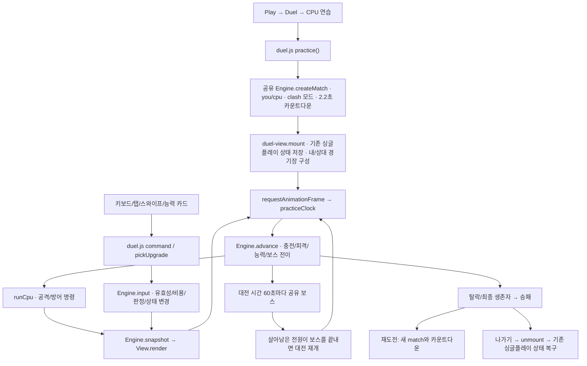

# 1.5.2 PvE 작동 흐름 및 검증

## 결론과 기준

제공된 1.5.2 소스의 PvE는 **CPU와 1대1로 겨루는 오프라인 듀얼 연습**입니다. 별도의 협동 PvE나 캠페인 모드는 아닙니다. 기존 싱글플레이/스테이지/보스 러쉬와도 별도 실행 경로입니다. 핵심 실행 흐름을 브라우저에서 확인했으며, 이번에는 AI/전투 수치/화면 배치를 수정하지 않았습니다.

원본 ZIP은 `imports/Neon-Parry-1.5.2-Source.zip`, 원본·LF 정규화 파일별 해시는 `imports/source-1.5.2-manifest.json`에 있습니다. 이전 저장소 기준은 `4e6ffe1`입니다. 첨부 README가 지목한 외부 저장소 커밋/Render 주소는 출처이며 이 작업에서 직접 일치 여부나 공개 운영 상태를 검증하지 않았습니다.

## 실행 흐름

### 진입·렌더러

`duel.js`는 `NeonDuelEngine`과 `NeonDuelView`를 사용합니다. CPU 연습은 서버 클라이언트를 생성하지 않고 `session='practice'`, `you/cpu`, `startAt=2200`, `mode='clash'`로 매치를 생성합니다. 매치 시드는 무작위로 정합니다.

`duel-view.js`는 기존 `#arena`, 캐릭터, 적 레이어, HUD를 재사용합니다. `mount()`에서 기존 싱글플레이 전역 상태와 DOM/레이어 자식을 저장하고 `mode='duel'`로 전환합니다. `unmount()`는 저장된 상태와 DOM을 복구합니다. 이 때문에 대대적 수정 시 전역 상태의 소유권과 복원 범위를 특히 주의해야 합니다. 상대는 별도 읽기 전용 장면이며 다인 PvP는 상대 타일을 생성합니다.

### 시간·입력·일반 전투

PvE는 `requestAnimationFrame`의 시간차를 최대 50ms로 제한하여 `practiceClock`을 누적합니다. 온라인은 별도의 서버 시각 보정 경로를 사용합니다. CPU 연습에서 서버 왕복 지연 보정은 필요하지 않습니다.

기본 패링은 ±360ms, 정밀은 ±100ms, 방향별 입력 대기 300ms입니다. 정상 패링은 공격을 제거하고 공격자의 연속 적중을 끊습니다. **PvE 기본 정밀 보상은 공격 에너지 +0.5**이며, 기존 싱글플레이의 기본 취약률 −4%p와 다릅니다. 정밀 수리 능력과 웜 정밀 패링은 별도 회복 규칙입니다.

수동 공격은 기본 에너지 1, 시작 2/최대 3, 기본 공격 대기 350ms입니다. 실제 충전율은 시간/능력에 따라 달라집니다. 공격 도착은 같은 수비자 기준 최소 520ms로 예약됩니다. 헛방어는 기본 +4%p이며 능력으로 줄일 수 있습니다. 기본 연속 적중 피해는 15→20→25%p입니다. 일반 대전은 취약률 100%에서 탈락합니다. 보스 피해 처리에는 기존 보스의 정확히 100% 생존/초과 시 탈락 규칙을 별도로 적용한 코드가 있습니다.

Shift+방향은 즉시 공격, Space/버튼은 공격 태세 선택, 탭은 패링, 라인을 따라 스와이프하면 공격합니다. 공격 발사 후 방어 태세로 돌아옵니다. 원래 게임과 듀얼의 입력이 중복 실행되지 않도록 활성 상태를 구분합니다.

### CPU AI

`duel.js runCpu()`는 엔진에 플레이어와 같은 `attack`/`guard` 명령을 넣습니다. 별도 CPU 피해 판정 코드는 없습니다.

| 수준 | 방어 시도 확률 | 예정 방어 시각 오차 | 공격 재시도/발사 간격 기준 |
| --- | --- | --- | --- |
| 입문 | 35% | ±210ms | 950ms + 성공 시 무작위 0~350ms |
| 대등 | 70% | ±170ms | 700ms + 성공 시 무작위 0~350ms |
| 숙련 | 90% | ±100ms | 550ms + 성공 시 무작위 0~350ms |

에너지 부족 등으로 공격이 거절되면 100ms 뒤 재시도합니다. CPU가 예정한 방어는 공격별 Map에 보관하고 해당 시각에 입력합니다. 확률상 시도하지 않는 공격도 있으므로 높은 수준에서도 무조건 방어하지 않습니다. 도메인 숫자 반응 단계에서는 순서 정답을 260ms 간격으로 직접 입력합니다. 일반 공격/방어 의사결정은 `Math.random()`을 사용하므로 매치 시드만으로 CPU 선택까지 완전히 재현되지는 않습니다.

### 능력 선택

`duel-engine.js`가 시작 8초 뒤 플레이어별 선택지 3개를 생성합니다. 선택 뒤 12초가 지나면 다음 제안을 생성하고, 미선택 제안은 남깁니다. CPU 연습의 사람 입력은 카드/1~3 키 → `pickUpgrade()` → `Engine.input(type='upgrade')`로 처리합니다.

후보는 추가 바이러스, 공격 속도, 충전 속도, 즉시 수리, 정밀 에너지, 공격력, 방어 에너지, 정밀 수리, 공격 효율, 코어 장갑, 헛방어 피해 감소의 11종입니다. 추가 바이러스는 최대 50%, 다른 누적 항목은 최대 100%, 즉시 수리는 누적형이 아닙니다.

**현재 CPU AI는 능력을 고르는 경로가 없습니다.** CPU의 공격/방어 확률·템포는 수준 프리셋이며, 사람과 같은 능력 성장 빌드를 사용하지 않습니다. 이 비대칭은 이번에 변경하지 않았고 향후 밸런스 논의 대상입니다.

### 보스 전환

서로 공격 가능한 대전 시간이 60초 지나면 페이크 도메인, 다음에는 디스-트로이가 번갈아 등장합니다. 두 참가자에게 같은 종류/시드의 독립 보스 상태를 줍니다. 이미 발사된 공격은 별도로 보관하고 상대 공격/능력 선택을 잠급니다.

먼저 보스를 끝낸 쪽은 대기합니다. 살아 있는 양쪽의 보스가 모두 끝나면 보스 소요 시간만큼 보관된 공격의 발사/도착/공개 시각과 다음 능력 제안 시각을 이동시켜 전투를 재개합니다. 다음 보스는 재개 60초 뒤입니다. 보스 때문에 한 쪽이 탈락하면 상대가 승리할 수 있으므로 항상 일반 전투로 돌아오는 것은 아닙니다.

`duel-boss.js`는 경고/접근/숫자 반응/분열 예고/재접근/처치·이탈 상태를 담당합니다. 이 모듈과 `duel-engine.js`는 브라우저와 Node 양쪽에서 사용됩니다. **이 파일을 바꾸면 PvE뿐 아니라 PvP 서버 판정도 바뀝니다.**

### 종료·복원·저장

승패 후 재도전은 기존 match를 재사용하지 않고 새 카운트다운과 초기 상태로 시작합니다. 경기 중 나가기 또는 Escape는 일시정지가 아니라 연습 종료/화면 복귀 경로입니다. 탭 비활성화는 `lastFrame`/터치만 초기화하며, 일반 싱글플레이와 같은 명시적 Pause/Resume 상태는 아닙니다.

CPU 연습 승패·능력 빌드는 현재 영구 진행 기록으로 저장하지 않습니다. 기존 싱글플레이/도전과제·도감 저장과 분리되어 있으며 복귀 시 원래 상태를 복원합니다. 장시간 백그라운드 동작, 재접속·세이브·이어하기가 필요하면 새 정책이 필요합니다.

## 실행 검증 결과

1. **첨부 원본**에서 `npm test`: 169 passed, 0 failed.
2. 원본 규칙을 수정하지 않고 두 보스의 종료 후 전투 재개 검사 1개를 추가했습니다. 현재 총 170개 검사를 CI에서도 실행합니다.
3. Chromium에서 데스크톱 1280×900, 모바일 세로 390×844, 가로 844×390, iPad 크기 820×1180을 확인했습니다. 입문/대등/숙련 진입, 키보드 공격, 터치 패링과 모바일 스와이프 공격, 3개 능력 선택, CPU 승리/사람 승리, 재도전·메뉴 복귀가 동작했습니다. 페이지 오류와 CPU 연습의 API 요청은 없었습니다.
4. 길게 진행한 브라우저 자동 입력에서는 도메인 시작 62.2초 → 일반 전투 복귀 75.25초 → 디스-트로이 시작 135.25초를 관찰했습니다. 이 사례는 두 번째 보스에서 CPU가 탈락해 158.95초에 사람 승리로 종료됐습니다. 별도 공유 엔진 검사에서는 양쪽을 정밀 방어시켜 두 보스 모두 처치 후 전투 재개까지 확인했습니다.
5. 장시간/승리 시나리오는 정상 입력 핸들러를 이용한 자동 입력과 50ms 프레임 진행으로 검증했습니다. 추가로 시계를 대체하지 않은 실제 rAF 진행에서도 CPU 공격→피해 누적→패배를 확인했습니다. 실제 사람의 난이도 체감/입력 지연 측정 결과는 아닙니다.
6. Node 22 Docker에서 통합 서버의 health, 게임 HTML과 CPU 연습 진입점이 정상 제공됩니다. 정적 Pages 빌드도 확인했습니다. 운영용 공용 PvP 서버를 새로 생성하거나 원격 서비스의 상태를 검증하지 않았습니다.

## 확인한 한계와 다음 수정의 기준

- **모바일 배치:** 390×844에서 내 경기장 약 210px/상대 약 136px로 축소됩니다. 844×390 가로 화면에서는 하단 나가기 버튼이 첫 화면 아래로 내려가 스크롤이 필요했습니다. 입력은 동작하지만 실기기에서 플레이 면적·조작 여유를 재검토할 필요가 있습니다. 이번에는 배치를 바꾸지 않았습니다.
- **AI 성장 비대칭:** 사람의 능력 선택에 비해 CPU는 기본 공격/방어만 사용합니다. PvE 성장·난이도 설계를 바꿀 때 우선 결정해야 합니다.
- **전투 엔진 공유:** PvE 전용 규칙을 바꾸려면 모드/정책 분리 없이 공용 RULES를 바꾸지 않아야 합니다. PvP 회귀 검사도 계속 실행해야 합니다.
- **화면 결합:** 기존 싱글플레이 전역 상태/DOM을 저장·교체·복원합니다. 입력·타이머·효과·HUD를 대대적으로 바꾸면 복원 회귀 검사가 중요합니다.
- **실기기 범위:** iPad Safari/Android 실기기, Windows/macOS Electron 실행파일, 공용 인터넷 PvP의 지연·다인전 품질은 이번 검증 범위 밖입니다.

## 가져온 코드에서 조정한 사항

게임 규칙·AI·렌더링은 첨부 소스 그대로이며 텍스트 개행만 CRLF→LF로 통일했습니다. 배포 설정의 정확한 Pages Origin 목록에 `https://qqock2e.github.io`를 추가하고 원본의 기존 Origin도 유지했습니다. 변경 파일은 `render.yaml`, `backend/.env.example`, `scripts/codespaces.cjs`와 관련 검사입니다.

README는 현재 저장소 기준으로 다시 작성하고, 추가 QA 검사·분석·매니페스트·개행 정책·루트 Docker 제외 설정을 보관했습니다. 원본 ZIP은 수정하지 않았습니다. 이후 기능 개편은 이 상태를 기준으로 진행합니다.
